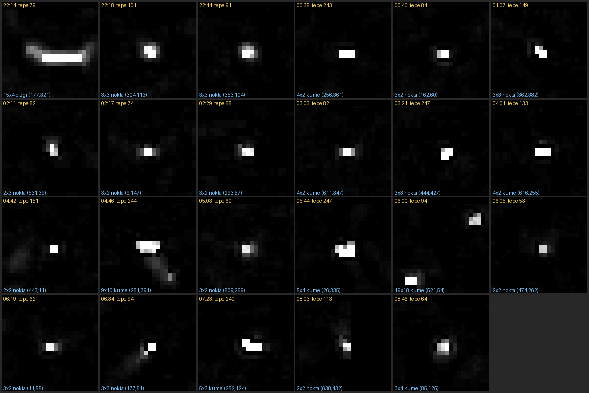

# aveo-av318s-re

Reverse engineering notes and tools for the **Aveo AV318S** USB 2.0 camera controller
(USB `1871:0f01`, "USB2.0 Camera") — plus a side project that turns a salvaged webcam
built on this chip into a **cosmic ray / radiation detector** on a Raspberry Pi.

As far as I could find, there is **no public documentation** for this chip. Everything here
was obtained by probing the device from Linux and by statically analysing the vendor's
Windows driver.

> 🇹🇷 Türkçe özet aşağıda.

---

## Hardware

| Item | Value |
|---|---|
| Controller | Aveo AV318S-3 (LQFP-48), date code `1042` (2010, week 42) |
| USB ID | `1871:0f01` — Aveo Technology Corp. "USB2.0 Camera" |
| Class | UVC 1.00 (works with Linux `uvcvideo` out of the box) |
| Formats | YUYV 4:2:2 (MJPEG also supported according to the Windows driver) |
| Regulator | SOT-89 marked `6206` (XC6206-style 3.3 V LDO), tab = VIN |
| Lens mount | M12 × 0.5 (S-mount), 12 mm |
| Wiring | 4 pads on board edge: 5V (next to U6) · D− · D+ · GND, standard USB order |

The module was salvaged with its original cable (USB + a 3.5 mm jack carrying an electret mic).

## What works on Linux

- Enumerates as UVC, `/dev/video0` (capture) + `/dev/video1` (metadata).
- Controls exposed by `uvcvideo`: brightness, contrast, saturation, gamma, sharpness,
  power line frequency.
- **No exposure / gain controls** are exposed — see [docs/usb-descriptors.md](docs/usb-descriptors.md).

## Findings (short version)

1. **Camera Terminal advertises no controls** (`bmControls = 0`). Sending the standard
   exposure / AE / gain requests directly returns STALL → they are genuinely unsupported.
2. **Extension Unit 4** (`{aab8f252-8ed1-4972-8ced-96b17f04408b}`) exposes a single 33-byte
   GET/SET control. The Windows kernel driver only passes it through to user mode; the program
   that builds the actual commands is not in the driver package.
3. The Windows driver controls the chip mainly through **vendor requests**
   (`bmRequestType 0xC2/0x42`). A command map was recovered —
   see [docs/vendor-commands.md](docs/vendor-commands.md).
4. **Vendor request `0x01` (IN)** reads a byte from the controller's internal register space.
   AE statistics blocks and "live" registers were identified —
   see [docs/register-map.md](docs/register-map.md).
5. Vendor `0x00` writes the controller's registers (volatile) — but the readable space seems to
   be a settings copy, not the live ISP. The Windows property page offers **no** exposure / gain
   control at all for this camera; the chip identifies itself with a fixed copyright string.
6. Bad-pixel correction, digital zoom and effects are done **in the Windows driver (software)**,
   not on the chip — so on Linux single bright pixels are *not* removed. Good news for particle
   detection.
7. **Firmware dump without any write:** vendor `0x01` actually reads the whole 64 KB 8051
   XDATA space. The RAM-resident firmware is there: two images, `OTP V001.00` (Jun 2010) and
   `OTP V006.00` (Sep 2010). The USB vendor requests themselves are handled in mask ROM.
   Vendor `0x09` only leaks old endpoint buffer data. See [docs/firmware.md](docs/firmware.md).
   The dump itself is not published (Aveo copyright).
8. **The image sensor is an OmniVision OV7725.** The UVC controls map to its DSP registers;
   exposure / gain are never exposed. Through the gamma table in firmware RAM
   (vendor `0x00` writes XDATA) **any OV7725 register can be written**. Manual gain is verified
   (AGC off). See [docs/firmware.md](docs/firmware.md) and `tools/sensor_yaz.py`.

> ⚠️ **Never send vendor requests `0x02` OUT, `0x03`, `0x07`, `0x08`** (persistent memory
> writes) **or `0x10` / `0x11`** (suspected to make the chip drop off the bus until physically
> unplugged — not confirmed, see docs). All tools here are read-only, except `tools/reg_yaz_test.py`, `tools/xdata_yaz_test.py`,
> `tools/sensor_yaz.py` and `cosmic/aveo_sensor.py`, which write volatile XDATA RAM only
> (vendor `0x00`).

## Cosmic ray detector

With the sensor completely covered (aluminium foil + black tape, kept in the dark), any bright
pixel cluster that appears in a single frame is a candidate particle hit (muons, gamma-induced
electrons). [cosmic/kozmik.py](cosmic/kozmik.py) builds a dark reference frame, masks hot pixels
and logs every event.

v2 (24 Nov 2026):
- per-pixel threshold `max(--esik, k·σ)`
- slowly updated reference (EMA over event-free frames)
- clusters split per frame, after-glow in the next frame ignored
- light-leak detection
- persistent hot-pixel mask (`maske.npy`); the 2 edge columns on each side are masked (noisy at
  high gain)
- automatic camera reconnect
- signed-diff crops saved (`olay_*.npz` + PNG)
- `olaylar_v2.csv` with header, `durum.json` status every minute
- **Sensor mode** `--mod manuel --kazanc 0xff [--pozlama N]`: AGC/AEC off via
  [cosmic/aveo_sensor.py](cosmic/aveo_sensor.py). Needs root for pyusb. Auto mode is restored on
  exit.

Note: in auto mode the OV7725 night mode (`COM5 = 0xD9`) halves the frame rate in the dark
(15.9 fps). Manual mode runs at 30 fps.

### First night (22 → 23 Nov 2026, ~10.5 h, sea level, indoors)

| | |
|---|---|
| Logged events | 70 |
| Rejected – settings changed during a register test | 43 |
| Rejected – one flickering hot pixel at (639, 322) | 3 |
| **Candidate particle events** | **24 → ~2.3 per hour** |
| Spatial distribution | uniform (left/right 13/11, top/bottom 13/11) |
| Very bright (peak > 200) | 5 |



Most events are compact dots (near-perpendicular hits), but **tracks appear in several
directions** — horizontal (22:14), diagonal (04:46, 06:34) and vertical (08:03). That rules out a
row-readout artifact. 06:00 shows two separate clusters in the same frame.
Sharp-edged 4×2 blocks are the camera ISP's fingerprint (YUYV chroma sharing + sharpening).

Tips: use YUYV (never MJPEG — compression destroys small hits), raise `brightness`
(e.g. 85) so the black level is not clipped to 0, run inside `tmux`.

## Repository layout

```
docs/      usb-descriptors.md, vendor-commands.md, register-map.md, firmware.md
tools/     read-only probing scripts (pyusb / UVC XU ioctl)
ghidra/    Ghidra scripts (Windows driver call arguments, 8051 firmware dump analysis)
cosmic/    cosmic ray detector script + sample events
```

## Vendor driver (not included)

The driver is **not redistributed** here (copyright of its owners). It can be downloaded from the
Microsoft Update Catalog by searching for `VID_1871&PID_0F01`
(entry "D-vitec – Streaming Media and Broadcast – Professional financial camera", 150 KB).
Analysed files: `dvitdcnt.sys` (v2.9.9.5, internally `aveodcnt`, x64), `CamIntfc.ax`, `dvitdcnt.inf`.

---

## 🇹🇷 Türkçe özet

Eski bir webcam'den sökülen **Aveo AV318S** kamera kontrolcüsü (USB `1871:0f01`) üzerine
tersine mühendislik notları ve araçlar. İnternette bu çip hakkında herhangi bir belge yok;
buradaki her şey cihazı Linux'tan yoklayarak ve üreticinin Windows sürücüsünü Ghidra ile
inceleyerek çıkarıldı.

- Kamera Linux'ta doğrudan UVC olarak çalışıyor, ama pozlama/kazanç kontrolü sunmuyor.
- Windows sürücüsünün kullandığı **vendor komut haritası** çıkarıldı. `0x01` ile çipin iç
  register alanı **sadece okunarak** incelenebiliyor.
- ⚠️ `0x02`, `0x03`, `0x07`, `0x08` komutları kalıcı belleğe yazar; **asla gönderme**.
- Yan proje: sensörü tamamen kapatıp karanlıkta kare kare izleyerek **kozmik ışın / radyasyon
  dedektörü** yapıldı (`cosmic/kozmik.py`). İlk ölçümde saatte ~5 olay.

Scriptlerin yorum ve çıktıları Türkçedir.

## Author

Bahadır Hamza Öztürk (TA2ETL) — <https://bahadirhamza.com.tr>
